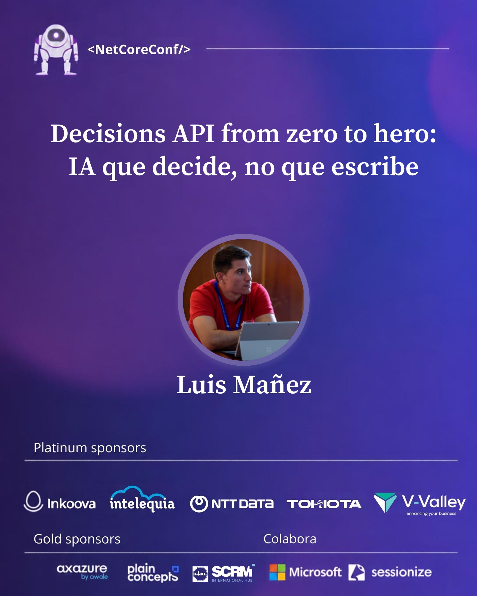

# Decisions API from zero to hero: IA que decide, no que escribe

This repository contains the materials, demos, and resources used during the session NetCoreConf Barcelona 2026 **Decisions API from zero to hero: IA que decide, no que escribe**.

## Session description

¿De verdad necesitamos un LLM generativo para todo? ¿Incluso para clasificar un documento, decidir qué herramienta debe ejecutar un agente o comprobar si una respuesta cumple determinados criterios?

Hasta ahora hemos utilizado LLMs para resolver muchos de estos problemas, pero acaba de aparecer una alternativa diseñada específicamente para tomar decisiones de forma rápida, estructurada y a un coste muy reducido: los **Decision Models**.

En esta sesión descubriremos esta nueva categoría de modelos de IA, centrándonos en **Microsoft-Decision-1**, disponible en Microsoft Foundry.

Empezaremos desde cero: qué problemas resuelve, en qué se diferencia de un LLM tradicional y cómo funciona la **Decisions API** para realizar clasificaciones, seleccionar entre distintas opciones o evaluar resultados mediante puntuaciones y probabilidades.

Y, como no podía ser de otra manera, pasaremos de la teoría a la práctica con una **demo en .NET**, donde integraremos Microsoft-Decision-1 en un escenario real y veremos cómo incorporar estas decisiones inteligentes a nuestras aplicaciones y agentes de IA.

Porque no todo necesita un LLM que genere texto. **A veces, lo único que necesitamos es que la IA tome una buena decisión.**

## 📚 Repository contents

- [`slides`](./slides) — Presentation slides
- [`src`](./src) — Source code and demos
- [`docs`](./docs) — Additional documentation and supporting material
- [`assets`](./assets) — Images and other session assets

## 🚀 About this session

This repository is intended to accompany the live session and provide attendees with access to the code, examples, and resources discussed during the presentation.

Feel free to explore the demos, reuse the examples, and open an issue if you find something that could be improved.

## 👨‍💻 Author

**Luis Mañez**

- GitHub: [Luis Mañez](https://github.com/luismanez)
- Microsoft Foundry MVP
- Chief Architect @ [ClearPeople](https://www.clearpeople.com/)

## ❤️ Supported by ClearPeople

My participation in community events and conferences is supported by **ClearPeople**.

Learn more about ClearPeople at [clearpeople.com](https://www.clearpeople.com/).

## 📄 License

Unless otherwise stated, the source code in this repository is available under the terms of the repository license.